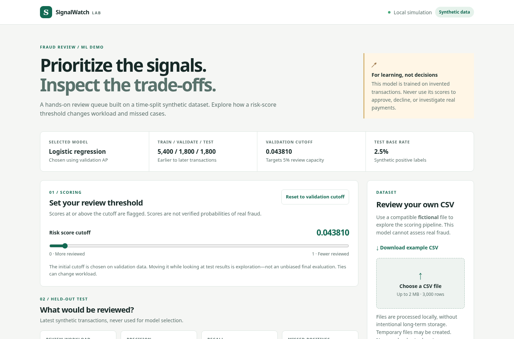

# SignalWatch — Fraud Review Lab



A local, educational **transaction review simulator** that trains a supervised ML model on invented data. Explore the trade-off between review capacity, precision and recall with a usable dashboard, chronological evaluation, a review queue, and per-transaction score-sensitivity inspection.

> **Synthetic only.** This is not a real fraud detector. The dataset, features and labels are invented. Do not upload real customer or financial data or use the model to approve, decline, investigate, or make decisions about transactions or people. There is no evidence of real-world accuracy, calibration, business value or regulatory suitability.

## Quick start (Windows)

1. Install Python **3.11, 3.12, or 3.13** from [python.org](https://www.python.org/downloads/) and select **Add Python to PATH** during setup.
2. Extract the ZIP. Open the extracted `SignalWatch` folder in File Explorer, click the address bar, type `cmd`, and press Enter.
3. In Command Prompt, run:

   ```cmd
   python run.py
   ```

   If needed, use `py run.py`. The first run creates `.venv` and installs dependencies, so internet access is needed. Every startup trains the local experiment; wait for **SignalWatch ready**. The browser then opens at **http://127.0.0.1:8010/**. Keep the terminal open; press **Ctrl+C** to stop.

4. Move the threshold slider and inspect the held-out queue. Click **Inspect** on a row to see score sensitivity. Click **Download example CSV** to try the fictional batch upload.

If port 8010 is already in use, use a new port:

```cmd
set PORT=8011
python run.py
```

Then open http://127.0.0.1:8011/. The app checks whether the port is in use before it opens a browser; if it cannot start, read the terminal error. A preflight check cannot eliminate all port races.

**macOS / Linux:** run `python3 run.py`. Change ports with `PORT=8011 python3 run.py`.

After dependencies are installed, training and use are offline; there is **no API key, generative AI service, account or GPU required**. On startup the model is retrained deterministically from the synthetic generator, instead of loading an untrusted pickled model. Small numeric differences can occur across software versions and platforms. Use `python run.py --no-browser` to skip opening a browser.

## What the application does

1. Generate 9,000 fictional timestamped transactions with an intentionally invented, stochastic label mechanism. There are no real people, financial records or currency units in the dataset. Fields such as `prior_24h_count` are simulated inputs, **not** reconstructed event histories.
2. Sort by time and use the earliest **60% for training, 20% for validation and latest 20% for testing**. Both preprocessing and classifier fitting use only training data. No random split, label or future outcome is used as a feature.
3. Train logistic regression and a random forest on the training split. Choose the model using **validation average precision (AP)**; select a cutoff at the validation top 5% score rank. Ties may lead to a different review rate. The model is not refitted on validation data.
4. Calculate metrics and show a queue for the later synthetic test period. Moving the threshold recalculates test precision, recall, workload and misses. The validation cutoff does not guarantee 5% workload on the test period or on later data.
5. A reviewer may inspect an individual score using a **one-feature-at-a-time replacement sensitivity**: replace each input with a training-set reference (numeric median, categorical mode) and recompute the score. A positive difference means the original value produces a higher score than the reference replacement. These are not SHAP values, causal effects, reasons for real fraud, or guaranteed explanations; replacement combinations can be unrealistic and model interactions matter.
6. Upload a compatible fictional CSV to score it with the **synthetic-trained** model. The app returns the highest 25 rows and total flagged count; this does not validate the model on the uploaded data. Uploaded labels, if present, are ignored. Test metrics remain about the built-in synthetic holdout, not the uploaded CSV.

All models and metrics are recomputed at startup. The data generator intentionally changes some feature distributions in the final period, but this artificial change is not a validated real-world drift simulation. A time split reduces one kind of look-ahead risk but does not prevent every kind of leakage, selection bias or distribution shift. The test split is not used in fitting, selection or cutoff selection; **developers inspected its results during development**, so it is not an untouched independent benchmark for final scientific claims.

## Reading the dashboard

- **Risk score:** model output, not a verified probability of real fraud. No calibration stage is implemented.
- **Review workload:** fraction with scores at or above the chosen threshold.
- **Precision:** positive labels among reviewed transactions, TP / (TP + FP). If no transactions are flagged, precision is undefined and shown as `—`.
- **Recall:** reviewed positive labels among all positives, TP / (TP + FN). If no positive labels exist, recall is undefined.
- **Missed positives:** simulated positive labels below the threshold. The queue shows the highest-scored 25 rows, **not** every case.
- **Validation AP:** a ranking metric that summarizes the precision–recall curve; model selection compares AP on validation data. It is not the same as precision at the current cutoff. [Scikit-learn precision–recall documentation](https://scikit-learn.org/stable/auto_examples/model_selection/plot_precision_recall.html).
- **Brier score:** mean squared difference between predicted scores and labels (lower is better), not by itself proof that probabilities are calibrated.

When you adjust a threshold while watching test metrics, you are exploring the test set. Do not then report the resulting test performance as an independent final evaluation. Choose a policy on validation data and evaluate once on a genuinely untouched future dataset for an independent assessment.

## Fictional CSV format

Download `examples/fictional_transactions.csv` from the dashboard. The input must be UTF-8 and include these columns:

| Column | Allowed values | Interpretation in simulation |
| --- | --- | --- |
| `transaction_id` | Optional text, 80 characters displayed | Identifier; not a model feature |
| `amount` | Number 0 to 1,000,000 | Invented amount units |
| `hour` | Integer 0–23 | Hour of day |
| `account_age_days` | Integer 0–36,500 | Simulated age of account |
| `prior_24h_count` | Integer 0–1,000 | Simulated prior count; no history calculation occurs |
| `new_device` | 0 or 1 | Simulated flag |
| `country_mismatch` | 0 or 1 | Simulated flag |
| `merchant_category` | `retail`, `travel`, `digital`, `grocery` | Simulated category |

Extra columns, including any `is_fraud` labels, are ignored for scoring. Files are limited to 2 MB and 3,000 rows. Errors identify the row where possible. The app does not intentionally persist uploads, but the server's multipart parser may use temporary disk files. The browser may retain the selected file for repeated threshold updates. Do not use sensitive data. There is no OCR, payment processing or live transaction integration.

## Project structure

```text
SignalWatch/
  run.py                       one-command local launcher
  app/data.py                  reproducible simulation + CSV validation
  app/ml.py                    chronological split, pipelines, metrics, sensitivity
  app/main.py                  FastAPI endpoints and local-only checks
  app/static/                  HTML, CSS, vanilla JavaScript dashboard
  examples/                    fictional CSV sample
  tests/                       unit and API integration tests
  docs/AUDIT.md                audit findings and limitations
  docs/RESULTS.md              actual development-run results and environment
  requirements*.txt            runtime and development dependencies
```

The `GET /api/report`, `GET /api/holdout`, `POST /api/score` and `POST /api/explain` endpoints are documented at http://127.0.0.1:8010/docs while the app is running. They are intended for local use only.

## Testing

After running the app once, from the project folder:

```cmd
.venv\Scripts\python.exe -m pip install -r requirements-dev.txt
.venv\Scripts\python.exe -m pytest -q
```

On macOS/Linux use `.venv/bin/python` instead. Tests cover chronological separation, validation-only model/threshold selection, metrics accounting, invalid CSVs, score inspection, upload behavior and localhost checks. They test software behavior, not real-world predictive performance.

The creation environment ran 31 tests and a browser-based smoke test; see `docs/AUDIT.md`. GitHub Actions is configured to run the tests on Python 3.11. A passing test suite is not evidence the system is fit for real fraud decisions.

## Safety, privacy and limitations

- The server binds to `127.0.0.1`, restricts Host and browser Origin and sets security headers. It has no authentication and is not safe to expose publicly or use as a shared service.
- Initial package installation requires internet; runtime does not call external AI services. Inputs and outputs can be sensitive even when processed locally; only use fictional data.
- Real fraud involves delayed or disputed labels, customer behavior, varying costs, access controls, compliance, bias, attacker adaptation and non-stationary data. None is solved here.
- The illustrative generator encodes the rules that create labels, so scores measured on its own synthetic data cannot establish transfer to actual transactions. The feature definitions are hypothetical.
- There is no model calibration, automatic blocking, realistic cost model, continuous production monitoring, user authentication or deployment infrastructure.
- Files may spool to temporary disk. Browser display and local security protections are not a formal security audit.

## How to discuss this project honestly

This codebase was generated with AI assistance. Before publishing it as your work, read it, run it, make changes and test them. Describe your actual contribution and disclose AI assistance where appropriate. Do not claim you trained on real financial data, built a production system, prevented fraud, achieved a real business outcome, or implemented a technique not present in the code.

Suggested study topics: supervised learning; class imbalance; precision/recall; average precision; leakage and temporal splitting; validation versus test sets; thresholds and capacity; model calibration; input validation; sensitivity analysis; safe data handling.

## Sources

- [Scikit-learn: precision–recall](https://scikit-learn.org/stable/auto_examples/model_selection/plot_precision_recall.html)
- [Scikit-learn: common pitfalls and data leakage](https://scikit-learn.org/stable/common_pitfalls.html)
- [Fraud Detection Handbook](https://fraud-detection-handbook.github.io/fraud-detection-handbook/): practical context for fraud evaluation. The bundled data are generated by this project, not the handbook.
- [Fraud Dataset Benchmark](https://github.com/amazon-science/fraud-dataset-benchmark): possible future research starting point; dataset-specific licenses and terms must be checked separately. No external fraud dataset is bundled.

## License

Project source and the bundled synthetic example: MIT; see `LICENSE`. Dependencies have their own licenses.

